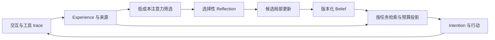

# Experience to behavior：成长研究的最小架构提案

更新日期：2026-10-24。状态：**独立成长研究的架构提案**；原方案与观察来自 2026-10-05，pilot 已实现部分核心路径，主 Agent 尚未集成持久成长。本次仅校准研究范围；本文的“第一阶段／第一版”均指研究实验，不作为 Nagi 联系人、事项和自主工作的交付前置。当前产品需求见 [Nagi 产品定义](../requirements/desktop.md)。

## 第一阶段验证范围

验证一次可核验经历能否形成条件判断，在以后新会话中改善工具行动、减少重复纠正，随后被相反证据修正。先在受控工程任务中检验，并计入用户投入及运行成本。

成长机制需要证明长期使用收益。若状态改变了行为，却增加返工、无效诊断或反复确认，应记录为负面结果；若简单的经历检索已能实现同样收益，就优先使用较简单的路径。

保留四个核心概念，不提前引入情绪向量、全局人格参数、复杂知识图谱或自动目标规划层。存储引擎、异步执行方式和最终 API 仍未决定。

Reflection 不在普通任务的同步必经路径上。第一版实验可以在任务结束后显式触发，无需先建设长期后台调度服务。

## Experience：事件与解释分离

不是每个 interaction 都必须立刻调用 LLM 生成 Experience 摘要。原始输入、输出、工具请求和结果已经是 cheap trace；任务边界及执行器提供的结果可先结构化记录。

| 字段候选 | 用途 |
| --- | --- |
| `id`, `task_id`, `event_type` | 标识事件与所属任务 |
| `occurred_at`, `recorded_at` | 区分发生与入库时间 |
| `actors`, `source_ref` | 区分是谁陈述、谁行动、谁观察结果 |
| `payload_ref` | 按需读取原始材料，避免重复大段 prose |
| `outcome` | 保存可核验的执行结果；无法验证时不冒充事实 |

Appraisal、意义和失败归因属于派生解释，不覆盖原始结果。一个 task 可以有多个事件，多个事件也可能共同支持一次反思。

## Belief：先表达条件判断

建议第一版字段候选：`id`、`proposition`、`scope`、`supporting_experience_ids`、`counter_experience_ids`、`status`、`version`、`updated_at`。

例如：“遇到尚未定位的核心子系统性能问题，先验证 bottleneck，再决定是否大改。”这比“所有大重构危险”更容易检查边界，也比人为修改 `risk_tolerance` 更接近可观察证据。

`status` 允许 provisional、contested 和 retired 等状态；最终枚举需由实际调用需求确定。数值 confidence 暂不作为必需字段，原因见[证据研究](../research/learning/evidence-and-beliefs.md)。

第一版 merge 仅处理命题与条件兼容的重复判断，合并来源引用；发现分歧先保留，而不是设计一个总能得出统一结论的 resolver。

## Reflection：提出更新，不重写整个个体

字段候选：`id`、`trigger`、`experience_ids`、`attribution`、`candidate_changes`、`unresolved_questions`。

reflection 可以提出创建判断、增加支持／反对证据、调整适用条件、退休旧判断，或者没有更新。模型生成 patch，写入层按目标 ID 和原版本应用；未涉及的状态不重新生成。结构合法不保证教训正确，仍需行动验证。

一次失败能否归因、同一来源是否被重复使用、改动是否越过支持范围，应成为具体检查点。第一阶段不要求每次更新都调用第二个模型评审，可先用受控实验验证这种写入路径。

## Intention：把判断连接到下一步

字段候选：`id`、`goal`、`proposed_action`、`reason_refs`、`status`。

第一版 Intention 可表达“先 instrument retrieval path”。它关联当前目标和相关判断，实际执行仍经过已有工具与权限边界。形成意图不授予额外权限，意图存在也不证明持续自主活动。

## Attention 与 reflection trigger

先使用可观察事件信号，而非每轮调用 LLM 打重要性分：工具失败、同类错误重复、用户明确纠正标记、可验证结果与预期不符、显式 milestone 或 commitment。用户的任意一句反对并不自动等于已验证纠正。

trivial／uncertain／salient 只改变检索优先级和反思候选队列，不删除来源。冲突检测可以只从显式关联与测试结果开始；不声称第一版规则能发现所有语义矛盾。

需要实验选择事件窗口、阈值、冷却时间和反思预算。暂不规定每 1000 次交互必须产生多少记忆或多少 belief 更新。

## Deep Self → Runtime Self

建议先用一个清晰的检索路径，按当前任务、适用条件和来源关系召回候选；没有证据前不同时建设多套检索实现。

投影内容按需要包括当前目标／承诺、少量相关判断、争议状态，以及可按 ID 读取的来源摘要。重要反对证据不能因“同意当前判断”权重更高而永久落选。

在实际目标模型 tokenizer 下实行总 token 上限；为主要任务、工具和推理保留预算，记录真实注入量。排名可以结合相关性、条件匹配、未决冲突和更新需要，具体权重待实验。先按需 render 简短结构，只有需要核验时展开来源。

严格小上下文意味着某些历史本轮不会起作用。需要测投影命中率及遗漏造成的行为差异，而不是承诺整个 Deep Self 总能同时参与判断。

## 与 compact 的边界及实施顺序

当前 [Agent::run](../../src/agent/mod.rs) 每次请求前检查自动压缩。用户选择第一版由 [Conversation](../../src/agent/conversation.rs) 完整处理预算、切分、摘要生成与应用；Agent 借出客户端和模型参数，并记录正常响应 usage、写入工具结果。没有实现手动命令或 command 系统。接口、预算与验证见[Conversation 自动压缩](conversation-compaction.md)。

[Context compaction](../research/systems/context-compaction.md) 保留 Codex、Pi、OpenCode 的固定版本研究，以及原先建议的职责划分供比较；原建议不代表本次实施决策。原始消息写入 session JSONL，成功 checkpoint 决定工作上下文；已实现 session 启动恢复，详见[会话管理](session-management.md)；这不等于已接入成长状态。

compact 管理当前任务的工作上下文，成长机制管理跨任务保留的经历与判断。一次 compact 不触发 Reflection，也不能把摘要当作新的独立证据。第一版保留 system、任务状态摘要和近期原始协议项；工具调用及对应结果成组处理，未完成调用不允许压缩。

用量优先采用响应 usage，尚未经过模型的新内容做轻量估算，不引入 tokenizer。容量来自 models.dev 缓存的匹配结果，匹配失败默认 256K，也支持显式配置；启动时按 24 小时 TTL 同步。跨任务经验投影仍需要单独上限，避免 compact 腾出的空间马上被长期状态占满。

离线验证已覆盖工具配对、长任务中间切分、连续 checkpoint、失败／截断与 usage 基线更新；真实入口自动压缩后继续回答的最小验收已通过；复杂任务摘要质量和长期任务收益仍需分别验证。下一阶段再接入受控的经历检索，比较它与反思所得判断的增益。

## 持久状态与身份边界

Experience、Belief 版本、Reflection、未完成 Intention，以及未来加入的承诺、关系和目标属于持久状态。runtime 投影、索引和缓存原则上应可从这些来源重建；如果压缩后丢掉唯一解释，则它已经不是纯缓存。

分叉记录共同祖先及之后独立更新。换模型保留状态，并执行同一行为回归任务，评估新引擎怎样解释旧判断。完整 identity 协议留待最小实验后设计。

## 尚未决定

| 问题 | 当前倾向／判断标准 |
| --- | --- |
| 是否需要独立 Belief 层 | 与原始 trace 检索比较；若无收益，优先简化 |
| 数值 confidence | 有明确语义、校准与行为用途后再加入 |
| 反思触发与预算 | 按实验成本和归因收益决定，默认允许不更新 |
| 长期存储与索引 | 先量化数据规模与查询需求，不提前选择复杂系统 |
| 偏好、价值与关系更新 | 不共用任务 reward 优化；需要独立研究 |

以[实验协议](../experiments/history-dependence.md)验证提案，再根据结果选择是否接入主 Agent。完整存储结构、长期调度和目标选择机制仍未决定。
